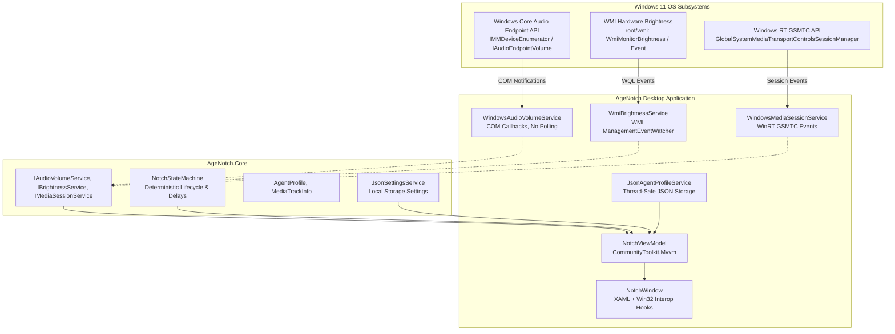

<div align="center">

# 🏝️ AgeNotch

### A Native Dynamic Island & System Notch for Windows 11

[](https://dotnet.microsoft.com/)
[](https://www.microsoft.com/windows)
[](https://docs.microsoft.com/dotnet/csharp/)
[](https://learn.microsoft.com/dotnet/desktop/wpf/)
[](tests/)
[](#architecture)
[](LICENSE)

*A sleek, top-anchored desktop notch for Windows 11 featuring organic bezel transitions, customizable dimensions and screen placement with real-time preview, zero-polling live hardware monitoring, Now Playing Music Control Center, contextual status HUD pills, and a modular AI agent workspace.*

---

[Features](#-key-features) • [Architecture](#-architecture) • [Getting Started](#-getting-started) • [System Integrations](#-live-windows-system-integrations) • [Roadmap](#-milestone-roadmap) • [Contributing](#-contributing)

---

</div>

## ✨ Key Features

- **🖤 Organic Flared Silhouette & Customizable Dimensions**:
  Custom procedural geometry (`NotchGeometryBuilder`) smoothly flares into the top display bezel with large rounded bottom corners (16–24px). Users can customize collapsed width (180–450px), height (28–56px), and screen placement (Center, Left, Right, or Custom Offset) with an interactive real-time monitor display simulation preview.
- **🎵 Music Control Center & Live GSMTC Integration**:
  Clicking the Now Playing card in the Nook opens a dedicated full-width Control Center with real-time GSMTC timeline tracking (elapsed and remaining time), seekable progress bar, dynamic equalizer visualizer wave, volume percentage, and source app branding badges (Apple Music, Spotify, Browser, etc.).
- **📅 Redesigned Nook Dashboard**:
  Three perfectly balanced cards: Now Playing card with source app badge, a 7-day horizontal calendar strip with a prominent active-today highlight capsule, and a clean profile avatar card.
- **⚡ Zero-Polling Windows Core Audio**:
  Real-time event-driven volume and mute synchronization via native COM interfaces (`IMMDeviceEnumerator`, `IAudioEndpointVolumeCallback`). Re-binds dynamically when audio endpoints (headphones, speakers) change without polling or CPU overhead.
- **☀️ Hardware Display Brightness**:
  Direct WMI hardware integration (`root\wmi` `WmiMonitorBrightnessEvent`) for instant screen brightness tracking, with graceful fallback on unsupported external monitors.
- **💊 Contextual Dynamic Island HUD Pill**:
  Hardware volume or brightness adjustments trigger a smooth, organic temporary HUD pill that settles back into the notch after 2 seconds.
- **🤖 Modular AI Agents Workspace**:
  Dedicated local agent management workspace with profile CRUD operations, role assignment (Orchestrator, Coder, Researcher, Vision, Tool User), and thread-safe persistence at `%LocalAppData%\GrumphySwarm\agents.json`.
- **🛡️ Focus-Safe Desktop Behavior (`WS_EX_NOACTIVATE`)**:
  Engineered with native Win32 extended window styles (`WS_EX_NOACTIVATE`, `WS_EX_TOOLWINDOW`, `MA_NOACTIVATE`). Interacting with the notch never steals keyboard or window focus from your active apps, games, or IDEs.
- **📐 High-DPI & Multi-Monitor Aware**:
  Listens to `WM_DPICHANGED` and monitor topology events via `DisplayManager`, automatically centering or positioning at `Y = 0` across dynamic resolution or scale factor shifts.
- **🚀 Single-Instance & System Tray**:
  Guarded by a native OS Mutex with custom tray icon controls for quick toggling, pinning, and clean exit.

---

## 🏗️ Architecture

AgeNotch adheres to **Clean Architecture** and **MVVM (Model-View-ViewModel)** principles with a strict separation between core domain logic and WPF presentation:



### Repository Structure

```
AgeNotch/
├── src/
│   ├── GrumphySwarm.Core/               # Framework-agnostic domain logic
│   │   ├── Abstractions/                # Core service contracts
│   │   ├── Models/                      # AgentProfile, MediaTrackInfo, AgentTaskType
│   │   ├── Settings/                    # Settings persistence & options
│   │   └── State/                       # Deterministic NotchStateMachine
│   └── GrumphySwarm/                    # Windows 11 WPF desktop application
│       ├── Animations/                  # NotchGeometryBuilder & Corner animations
│       ├── Converters/                  # XAML UI value converters
│       ├── Interop/                     # Win32 P/Invoke, CoreAudio COM, DisplayManager
│       ├── Lifecycle/                   # SingleInstanceMutex & TrayIconManager
│       ├── Resources/                   # Segoe UI Variable styles, Dark palette, Icons
│       ├── Services/                    # Audio, Brightness, GSMTC, & Profile services
│       ├── ViewModels/                  # NotchViewModel & AgentItemViewModel
│       └── Views/                       # NotchWindow (XAML + HWND Interop)
└── tests/
    └── GrumphySwarm.Tests/              # 42 Automated Unit & Integration Tests (xUnit)
```

---

## 🔌 Live Windows System Integrations

| Feature | Windows Technology | Description |
| :--- | :--- | :--- |
| **Master Volume & Mute** | `IMMDeviceEnumerator`, `IAudioEndpointVolumeCallback` | Zero-polling COM notification client. Instantly syncs with keyboard media keys and taskbar slider. Auto re-binds on default device changes. |
| **Screen Brightness** | `root\wmi:WmiMonitorBrightnessEvent` | Event-driven hardware brightness telemetry with zero CPU usage. |
| **Media Playback** | WinRT GSMTC (`Windows.Media.Control`) | Universal media controls for Spotify, Chrome, Edge, Apple Music, VLC, and other Windows players. |
| **Window Non-Activation** | `WS_EX_NOACTIVATE`, `MA_NOACTIVATE` | Clicks and hovers do not activate the window, preserving foreground application focus. |
| **Multi-DPI Layout** | `WM_DPICHANGED`, `PerMonitorV2` | Crisp rendering and proportional scaling across 100%, 125%, 150%, and 200% displays. |

---

## 🚀 Getting Started

### Prerequisites
- **Operating System**: Windows 11 x64 (Build 19041+ or later)
- **Runtime / SDK**: [.NET 10 SDK](https://dotnet.microsoft.com/download)

### 1. Clone the Repository
```bash
git clone https://github.com/cryoxyl-beep/AgeNotch.git
cd AgeNotch
```

### 2. Run Automated Tests
```powershell
dotnet test
```
*Executes all 42 unit and integration tests covering the state machine, Core Audio callbacks, WMI brightness, GSMTC media session, and profile persistence.*

### 3. Run in Development Mode
```powershell
dotnet run --project src/GrumphySwarm/GrumphySwarm.csproj
```

### 4. Publish Standalone Release (Single Executable)
Produce a self-contained binary that runs on any Windows 11 machine without requiring a pre-installed .NET runtime:
```powershell
dotnet publish src/GrumphySwarm/GrumphySwarm.csproj -c Release -r win-x64 --self-contained true -o publish/win-x64
```
The resulting executable will be available at:
```
publish/win-x64/GrumphySwarm.exe
```

---

## 🕹️ Controls & Interaction

- **Hover**: Move cursor over the collapsed notch to expand the dashboard smoothly downward.
- **Collapse Grace Period**: Moving mouse away starts a smooth 350ms collapse countdown.
- **Pin / Unpin**: Click the pin icon in the upper-right corner of the expanded panel to lock the notch open.
- **Tab Navigation**: Switch between **Nook** (Live Media, Calendar, User profile) and **Agents** (AI Agent fleet workspace).
- **Volume & Brightness HUD**: Changing volume or brightness via keyboard keys displays a contextual HUD pill even while collapsed.
- **System Tray**: Right-click the system tray icon to toggle the notch, pin it, or cleanly exit the application.

---

## 🗺️ Milestone Roadmap

- [x] **Milestone 1**: 
  - [x] Windows 11 native topmost notch host.
  - [x] Organic flared silhouette attached to top screen bezel.
  - [x] Event-driven Core Audio volume and mute sync (zero polling).
  - [x] WMI hardware brightness tracking with fallback.
  - [x] Windows GSMTC live media player integration.
  - [x] Contextual Dynamic Island status HUD pills.
  - [x] Agents tab with local CRUD profile management.
  - [x] 42 automated tests & self-contained win-x64 publication.
- [ ] **Milestone 2**:
  - [ ] Local AI model inference execution (ONNX / DirectML / Ollama).
  - [ ] Active subagent task orchestration and background execution engine.
  - [ ] Screen understanding, OCR, and context capture tools.
  - [ ] Desktop pets with autonomous state-based physics and animations.
  - [ ] Third-party app connectors and automation triggers.

---

## 📄 License

This project is licensed under the [MIT License](LICENSE).

---

<div align="center">
  <sub>Crafted for Windows 11 desktop enthusiasts. Built with C#, WPF, and .NET 10.</sub>
</div>
